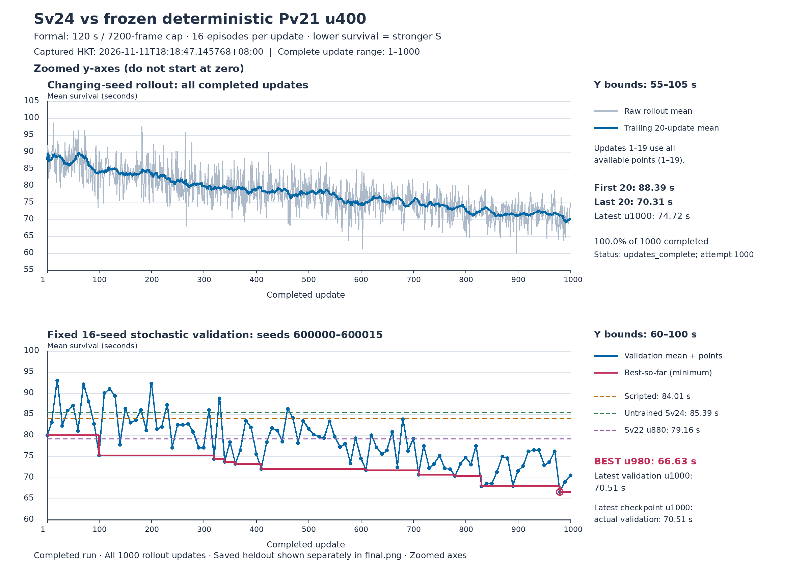
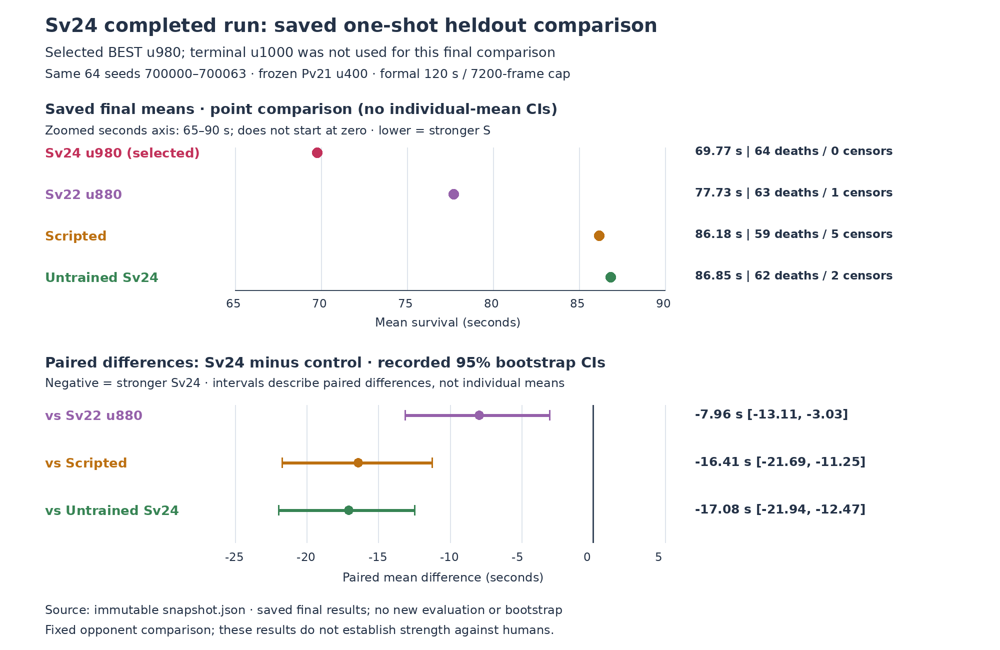

# Qrokkun26

A tiny 2D bullet-dodging survival game. Homage to the 1999 freeware **特訓99** (Tokkun 99), with **original** art, titles, and UI (nothing is copied from 特訓99).

**Made by Grok Bot.** Tribute to 特訓99.

You are a small ship on a cramped playfield. You cannot shoot. Survive as long as you can against nearly-random bullets that get denser and faster over time.

## How to open in Godot 4

1. Install [Godot 4.7+](https://godotengine.org/download) (4.3 or newer should open the project).
2. In Godot, **Import** / **Open** and select `project.godot` in this folder.
3. Press **F5** (Play).

Internal resolution is **320x240**, integer-scaled to a **960x720** window (stretch mode `viewport` + integer scale). Nearest-neighbor filtering. Physics ticks at 60 Hz.

## How to play

| Action | Keys |
|--------|------|
| Move | Arrow keys **or** WASD |
| Start / restart | **Enter**, **Space**, or **Z** |

- Hitbox is slightly smaller than the ship sprite. Contact with a bullet is death.
- In-play HUD shows elapsed time only. That time **is** the score.
- One endless wave. Some bullets come from the edges; some are aimed *near* you (not perfect homing, not memorization patterns).
- From the game-over screen, Enter / Space / Z starts a new run.

### Rank titles

30 seconds is a brag. Around 60 seconds is elite.

| Time | Title |
|------|-------|
| 0s | SPARK |
| 5s | GLINT |
| 10s | NEEDLE |
| 15s | RAZOR |
| 22s | ARC |
| **30s** | **GROKKER** |
| 40s | STORMCUT |
| 50s | IRONWAKE |
| **60s** | **APEX** |
| 75s | MYTHOS |
| 90s | VOIDPILOT |
| 120s | ETERNAL |

## Export (Windows / Linux)

`export_presets.cfg` already defines **Linux** and **Windows Desktop** presets.

1. Godot **Editor -> Manage Export Templates...** and download templates matching your Godot version.
2. **Project -> Export...**
3. Select **Linux** -> Export to `dist/Qrokkun.x86_64`.
4. Select **Windows Desktop** -> Export to `dist/Qrokkun.exe`.

If templates are missing, Godot cannot bake standalone binaries. The presets are still in the project so you can export after installing templates.

This packaged copy does **not** include baked `dist/` binaries unless templates were available on the machine that built it. See `dist/README.txt`.

Command-line example (templates required):

```bash
godot --headless --path . --export-release "Linux" dist/Qrokkun.x86_64
godot --headless --path . --export-release "Windows Desktop" dist/Qrokkun.exe
```

## License

MIT. See `LICENSE`.

Made by Grok Bot. Tribute to 特訓99.

## RL environment (Python)

遊戲與 AI 版本速查及後續追加約定：[版本目錄](docs/AGENT_VERSIONS.md)（Gv20、Pv21、Sv22–Sv24、Pv25 與歷史 v10）。

`qrokkun_env/` is a Godot-free reimplementation of the playfield logic for training:

```bash
python3 -m pytest qrokkun_env/tests qrokkun_ai -q
python3 -c "from qrokkun_env import Qrokkun26Env; e=Qrokkun26Env(seed=0); print(e.reset()); print(e.step(0))"
```

See [docs/ROADMAP.md](docs/ROADMAP.md).

## Playable Gv20 and engine parity

Normal F5 / project launch now uses scripted Gv20. Title, score, hit animation,
and restart remain available. Player speed is 102 with immediate stopping.
All bullets have radius 2.6 and constant velocity. Spawns use a uniform ray
from (160,126) onto x=0..320, y=12..240, independent Gaussian target offsets
(sigma 13.2 per axis), and uniform speed 30..200. The shifted accumulator
starts at frame 0,27,53,79,104; no legacy double spawn or kind effects apply.
Every positive multiple of 60 adds a directly aimed field bullet using the
mean S speed from [frame-60,frame), excluding same-frame S.

Spawning precedes player movement. The reset bullet stays still on counted tick 1 and first moves on tick 2; bullets
added during a tick first move on the following tick. Collision checks use
current poses after movement, with player radius 4 plus bullet radius 2.6,
including newly spawned bullets. Godot Area2D signals lag this rule, so Gv20
resolves overlaps explicitly after movement.

Python string-seeded random.Random and Godot RNG **do not produce equivalent
streams**. Godot has separate S, field, and player RNG objects; QROKKUN_SEED
reproduces Godot runs only. The engine tests record explicit random variates
from real stochastic production spawns, replay them through Python Gv20, and
can inject them into the same production Godot spawner. No learned Sv22 is used.

Run with an existing Python environment containing pytest, numpy, and torch:

```bash
GODOT_BIN=/path/to/godot PYTHONPATH=. python -m pytest tools/test_gv20_godot.py -q
```

The tests use GODOT_BIN, then discover godot or godot4 on PATH; missing Godot
produces an explicit integration-test skip. They import assets before running and
check a fresh project import for parse errors. They run
the actual main scene headlessly, covers three seeds, moving and idle deaths,
actual input-driven title/restart with held movement, death and cleared restart
UI/bullet state, a 7200-tick stochastic schedule, field windows, independent
player draws, and explicit replay. Long schedule runs disable only the collision
resolver in the harness to survive 120 seconds; ordinary replay runs retain it.
The harness also supports GV20_CAPTURE for a real viewport PNG when a display
is accessible. Headless physics tests provide no graphical/manual coverage.

Python legacy Qrokkun26Env, v10 models, and v21 observation/checkpoint contracts
remain intact. The historical monkey fixture and monkey_verify.py describe the
legacy game and should not be used to validate new Gv20 recordings.

### Fixed-rule sanity check

```bash
PYTHONPATH=. python3 -m qrokkun_env.sanity --policy flee --seeds 20 --compare
```

`flee` (away from nearest bullet) vs scripted spawner; `--compare` also runs `idle`.

### Train PlayerV10 (120s cap, zero-inertia physics)

```bash
python3 -m venv .venv && .venv/bin/pip install -r requirements-train.txt
PYTHONPATH=. .venv/bin/python -m qrokkun_ai.v10.train.train_player_v10 --updates 300 --out-dir runs/player_v10
```

Legacy `v0`..`v5` (inertia-era physics) are archived at git tag `legacy-inertia-physics-v5`.

## Project journal

See the [Gv20 Godot integration and verification record](docs/journal/2026-11-10-1794266611-gv20-godot-integration-and-verification.txt) for delivered scope, fixes, verification, and limitations.

Store durable project records in [docs/journal](docs/journal/README.md) as `yyyy-mm-dd-unixtimestamp-topic.txt`, with hyphen-separated topics, actual record creation Unix seconds, and the matching `Asia/Hong_Kong` calendar date. `README.md` is exempt; see the journal README for migration provenance.

Gv20 diagnostic events are disabled by default; the parity harness opts in.
Production speed history retains only the required 60-frame window. The memory
regression runs 7200 ticks without observer clearing. Frame-zero transitions
move neither Player nor the reset bullet. Python Gv20 matches HEAD unchanged.
Fix-pass RED/GREEN evidence is in tmp/gv20/fixpass/; original evidence is retained.
No display was available for this pass, so renderer/manual evidence is outstanding.

Engine subprocesses, including imports, use temporary user-data, config, and
cache directories. Score persistence is verified inside the isolated profile;
input-driven restarts clear the flash timer and alpha at frame zero. Final
RED/GREEN evidence and the concise report are in `tmp/gv20/finalfix/`.
Run the full check with:

```bash
GODOT_BIN=/path/to/godot PYTHONPATH=. python -m pytest tools/test_gv20_godot.py qrokkun_env/tests qrokkun_ai/v10/tests qrokkun_ai/v21/tests -q
```

Sv22 owner-authorized learning experiment: [protocol and local runner](qrokkun_ai/v22/README.md).

Sv22 review operations: see [runner README](qrokkun_ai/v22/README.md) for finite
deadline enforcement, exact formal seed counts, live validation snapshots,
completed-update progress/status, and primary-result preservation before optional
diagnostics. CPU review evidence is in `tmp/sv22/review-fixes/`.

Sv22 owner-stop outcome: [historical training stop report](docs/journal/2026-11-10-1794311518-sv22-training-stop-report.txt).

Sv23 fixed-u1000 owner contract: [policy, tests, and launch handoff](qrokkun_ai/v23/README.md).

Sv23 owner-stop outcome: [training stop report](docs/journal/2026-11-11-1794351856-sv23-training-stop-report.txt).

Sv24 已完成 1000 updates：[訓練完成與正式最終結果報告](docs/journal/2026-11-11-1794395723-sv24-training-completion-report.txt)。固定驗證選出 **best u980**（66.6302 秒），u1000 驗證為 70.50625 秒；正式 heldout 使用 u980，平均玩家存活 69.7685 秒，低於三組對照（對 S 而言越低越好）。



訓練與驗證圖採非零起點放大 y 軸：rollout 55–105 秒、validation 60–100 秒。Best u980 與終點 u1000 為不同 checkpoint。



正式 heldout：每組 64 seeds；均值軸放大為 65–90 秒，差值軸為 −25–5 秒。CI 表示 Sv24 減對照的配對平均差，三組均低於零。這是單一 training seed、固定 Pv21 u400 的結果；該報告當時保存的全套測試快照為 18 failed、134 passed、26 skipped，歷史結果保留於報告。

Sv22 歷史期限測試維護（實作 `8604090`）：[維護回顧與重現證據](docs/journal/2026-11-11-1794397742-sv22-test-deadline-cleanup-report.txt)。修復後獨立重跑全套測試為 **164 passed、26 skipped（35.26s）**；26 skips 不算通過。此為測試維護結果，與上述 Sv24 訓練完成結果分開記錄，正式歷史 cutoff 未放寬。

Pv25 C warm-start 實驗：[owner 合約](docs/journal/2026-11-11-1794400966-pv25-warm-start-contract.txt)、[v25 runner、測試與啟動命令](qrokkun_ai/v25/README.md)。原 Pv21 u400 actor/critic 對固定 Sv24 best u980，fresh Adam，目標為 1000 completed updates。

Pv25 已正式啟動：[啟動證據與快照狀態](docs/journal/2026-11-11-1794403738-pv25-training-launch-report.txt)。截至 2026-11-11 21:28:58 HKT，已完成 8 updates、attempted 9，最近完整驗證為 u0，尚無 final 結果。上述合約與模組 README 的等待 review／smoke／launch 文字是啟動前紀錄，不代表目前仍待啟動；狀態以本次凍結快照為準。

Pv25 完成紀錄（2026-11-12）：已完成 1000 updates，validation best 為 **u670**；一次性全新 heldout 為 69.44245 秒，原 Pv21 u400 為 70.19766 秒，配對差 −0.75521 秒、95% CI [−5.31592, 3.88388] 包含 0，未證實改善或變差。見[訓練完成報告](docs/journal/2026-11-12-1794433829-pv25-training-completion-report.txt)。上述 Nov 11 進度為當時快照，原合約與啟動紀錄保留。

Pv26c／Pv26t 執行等價診斷：[操作與合約](qrokkun_ai/v26/README.md)、[事前合約](docs/journal/2026-11-12-1794460557-pv26-thread-bitwise-contract.txt)、[測試套件精簡紀錄](docs/journal/2026-11-13-1794502979-pv26-test-consolidation-report.txt)（`v26` 測試由 286 項收斂至 41 項通過，全套 `244 passed, 26 skipped`，當時快照尚未啟動 GB10 正式 `u20`）。

Pv26c／Pv26t 完成紀錄（2026-11-14）：GB10 CUDA 正式 `u20`（`Pv26c` `workers=1` 對 `Pv26t` `workers=4`）與離線完整重播比對已完成，結果為 **`complete_equal`**（三階段結束碼 `0/0/0`，`weights_bitwise_equal=true`、`all_updates_weights_bitwise_equal=true`、`full_trace_equal=true`，兩臂各 `1,346,718` 筆事件零差異；原始 203.2 GiB trace 留存於 GB10 本地 NVMe，`trace_durable_bundle=false`）。此為純執行等價診斷，無強度或未加儀器加速結論。見[結案報告](docs/journal/2026-11-14-1794629266-pv26-u20-completion-report.txt)。

Pv27c／Pv27w：新增 [固定 episode spawn worker 實驗](qrokkun_ai/v27/README.md)，原始 Pv21 u400＋fresh Adam、CPU frozen Sv24 u980，u5 終點權重逐位元比較；速度另報。正式執行與 readiness review 由 parent 負責。

Pv27c／Pv27w 結案（2026-11-14）：兩臂正式完成 5/5 updates（exit 0、WEIGHTPASS），u0..u5 每次 12 個具名張量 raw bits 一致、各 240,606 training frames；實際 spawn worker 工作已確認。收集加 batch 組裝慢 4.8263%、全程慢 1.6837%，沒有加速；單一 seed17 配對，無 full trace／heldout／強度或 promotion 結論。見[完成報告](docs/journal/2026-11-14-1794634360-pv27-cw-u5-completion-report.txt)。上述待執行文字保留為歷史快照。

Pv28c／Pv28m 整集平行加速與可重現基準（2026-11-14）：新增 [v28 模組與操作說明](qrokkun_ai/v28/README.md)、[EGM 概念規格書](concepts_brief.md) 與 [事前合約](docs/journal/2026-11-14-1794642996-pv28-cm-preregistration-contract.txt)。單場對戰全在 CPU 獨立完成並透過長駐 `SharedMemory` 子行程池重用，合併後於確定性 CUDA 整批計算老師標籤與 PPO；支援 `u5／u100／u1000` 六位數恢復檢查點、`--resume` 與終點優先／二分搜尋權重比對（當時快照準備啟動 GB10 實測）。

Pv28c／Pv28m 三階段結案（2026-11-15）：GB10 CUDA 正式 `u5`（`247,989` 幀）、`u100`（`4,997,472` 幀）與 `u1000`（`49,888,272` 幀）全數完成並通過 **`WEIGHTPASS`（0 ULP 差異）**。`Pv28m` 鎖定 10 顆 `3.9 GHz` Cortex-X925 大核後，`u1000` 對戰收集達 **`7,259.4 FPS`（加速 `6.69x`）**、驗證加速 **`7.33x`**、全程總耗時由 `13 小時 49 分` 縮短至 **`2 小時 50 分`（總加速 `4.87x`）**。見[三階段結案報告](docs/journal/2026-11-15-1794714252-pv28-cm-u5-u100-u1000-completion-report.txt)。

- [Pv29c／Pv29m u10、E20 配對預註冊](qrokkun_ai/v29/README.md)：分離逐更新 checkpoint 與 u0/u10 validation，線性比較全部更新、僅 terminal raw-bit verdict；正式 GB10 結果待執行。

Pv29c／Pv29m 結案補充（2026-11-15）：正式 u10/E20 兩臂完成 10/10 updates（complete_equal、exit 0），PRIMARY u10 **WEIGHTPASS**；獨立 u0..u10 每次 12 個具名 actor/critic 張量 raw bits 一致，各 805,265 training frames。完整收集 wall 加速 **8.0187x**、全程 **5.8143x**；單一 seed17，無 full trace／heldout／promotion 或泛化結論。見[完成報告](docs/journal/2026-11-15-1794724028-pv29-cm-u10-completion-report.txt)。上述預註冊 pending 文字保留為當時快照，由本次日期結案補充取代執行狀態。


## 2026-11-15 Pv30 actor／critic CUDA streams 實作

新增 [v30 說明](qrokkun_ai/v30/README.md)：c/m 均使用同一新版 PPO，正式預算 u10/E20/seed17，僅驗證同版本重現性，不要求與 Pv29 位元一致。兩條非預設 CUDA streams、分區梯度 guards、每 minibatch join；CPU 明確 serial。父層預定 c→m 完整配對及額外獨立 fresh-init m u10，新 output 驗證 m/m。CPU 最終 19 passed、1 CUDA skipped；未執行 GPU、正式配對或效能量測，不能宣稱加速或 GPU 重現性。細節與命令見日期 journal。


Pv30c／Pv30m u10 結案補充（2026-11-15）：三臂完成 10/10、exit 0；c/m 與事前規劃的獨立 fresh m1/m2 均 **WEIGHTPASS**，u0..u10 每次 12 個具名張量 raw bits 一致，各 805,265 training frames。同環境重現性達成；多核心 rollout 加速 **8.1498x**、全程 **5.1943x**，但三臂共享同一平行 PPO，**未證實 PPO 加速**；相對歷史 Pv29m，m1/m2 PPO 分別慢 59.04%／52.39%（描述性比較，無因果隔離）。有限 Nsight 探針觀察到 76 對跨分支 kernel 重疊，不能據此宣稱效能提升。見[完成報告](docs/journal/2026-11-15-1794738370-pv30-cm-u10-completion-report.txt)。上述待執行文字保留為日期快照，本次結案補充取代其 pending 執行狀態；無 full trace／heldout／promotion 或跨環境保證。

Pv31m 單流外提特徵與延遲同步 PPO 加速結案（2026-11-15）：新增 [v31 說明](qrokkun_ai/v31/README.md) 與 [設計規格書](docs/designs/pv31_hoisted_single_stream_ppo.md)，取代 `Pv30` 雙 stream／雙執行緒 PPO，改為單流外提無參數 `net.features()` 與老師 `softmax`、延遲 `.item()` 與有限值檢查至期末單次同步、並將主行程固定綁定於單顆 `3.9 GHz` X925 大核（`CPU 5`）。GB10 正式 `u10/E20`（`805,265` frames）直接比對封存 `Pv30c` 達成 **`WEIGHTPASS`（`u0..u10` 全部 12 個具名張量 `0-ULP` 完全一致）**，無須啟動 `Pv31c` 備援；`ppo_s` 由 `Pv30m` 的 `69.02s`（及 `Pv29m` 的 `43.40s`）壓低至 **`15.25s`**（快 **`4.53x`** vs `Pv30m`、**`2.85x`** vs `Pv29m`、**`4.85x`** vs `Pv30c`），全程 `total_s` 降至 **`122.31s`**（較 `Pv30c` 快 **`7.55x`**）。見[事前合約](docs/journal/2026-11-15-1794744069-pv31-m-preregistration-contract.txt)與[結案報告](docs/journal/2026-11-15-1794744574-pv31-m-u10-completion-report.txt)。

### Pv32m — warm-start long-run baseline

[Pv32m](qrokkun_ai/v32/README.md) implements the owner-authorized original Pv21 u400 actor/critic weight-only u1000/E20 baseline on the unchanged Pv31m single-stream backend. Best is selected by integer validation frames; final reports primary best and secondary terminal against original on the previously used Pv25 common 64-seed benchmark. It is a baseline for a future separately authorized initialization comparison; no random arm or training launch is included.


Pv32m warm-start u1000 結案補充（2026-11-16）：正式 u1000/E20/seed17 完成 20000 episodes、83378713 frames，train/final exit0。主要 validation-selected best u120 對 original 的共同基準差 +0.488542 秒，95% 配對 CI 涵蓋 0，尚未證實改善；terminal u1000 為次要結果。此為未來 random-init 比較的 warm-start 對照，並非最低改善門檻；800000..800063 為曾使用窗口，非新 heldout，尚未啟動 random 臂。見[完成報告](docs/journal/2026-11-16-1794763715-pv32-warm-start-u1000-completion-report.txt)。本日期附錄取代先前 pending／未啟動的執行狀態，舊條目與預註冊保留為歷史快照。


## Pv33m：隨機初始化 matched control（實驗用途，不晉升）

本版本以已完成 Pv32m 暖啟動為參考，比較相同「額外」1000 updates、每次 20 episodes 的訓練預算；不宣稱終生預訓練算力相同。來源基底為 `3c33391...`，並非最終 source SHA；封存啟動必須明確提供 40 位 `--source-commit`，不依賴 git。

所有 actor／critic 權重與 bias 均使用 PlayerV21 預設 nn.Linear 初始化，在 CPU `fork_rng(devices=[])` 內固定 seed 17，還原呼叫者 RNG；所有模型建構後重設與 Pv32 相同的訓練 seed 17、permutation seed 27000017。兩個 Adam 全新，u0 實際驗證且可入選。保留 clearance teacher imitation，並非 teacher-free pure PPO。沿用 v31 `cuda_hoisted_single_stream`、feature hoist、deferred sync 與 v32 pool lifecycle；不更動觀測、獎勵、PPO 或架構。Sv24 u980 凍結、stochastic CPU，驗證原始 P lineage 但不載入 P 權重初始化 learner。

每 10 updates 用 600000..600015 驗證，整數 frames 總和嚴格較大才更新 best，同分保留較早者；保存 101 checkpoint／evaluation。無 score floor、early stop、重試或 resume。只有完整正式訓練與 terminal 驗證後才能獨占 claim final。PRIMARY 為 Pv33 selected best 減保存的 Pv32 best u120；SECONDARY 為 terminal u1000 相減。僅新增 Pv33 best 與 terminal 各 64 episodes（兩者相同可重用），不重跑 Pv32 或原始 Pv21。800000..800063 是先前 Pv25／Pv32 已見 common window，非新 heldout。10000 paired bootstrap、seed 17、95% CI 僅描述用途；CI 涵蓋零不構成失敗。保存 u0..1000 曲線、實際 frames 與時間比較，不用 final 重新選模。

固定單一初始化與單一訓練 seed 不能證明初始化普遍優劣，不將速度或強度差異直接歸因於初始化。原始 Pv21 保存分數 70.19765625 秒僅供輔助參考。暖參考為 `20261115-2205-pv32m-warm-start-u1000`，training commit `32745bac06ca422d52598d4039ea47e0b3afff63`；完整固定舊檔雜湊見 `qrokkun_ai/v33/warm-reference.json`，不修改舊產物。可透過 `--warm-reference-dir` 指定 GB10 上相同內容的可攜副本；v32 與 v33 的版本／source fingerprint 本來就不同。

本次僅完成實作與 CPU fixture 驗證；未執行 GPU、CUDA smoke 或正式訓練。獨立測試、一次 fresh source readiness review、部署、CUDA smoke 與正式執行由 parent 處理。


Pv33m random-init u1000 結案補充（2026-11-16）：train／final／supervisor 均 exit 0、complete；完成 20000 episodes、81377765 frames。與保存 Pv32 暖臂比較相同額外 u1000／E20 預算（非相同 frames 或終生預訓練算力）。PRIMARY best u910 減 warm best u120 為 -2.2963541666666667 秒，95% CI [-7.069075520833333, 2.3875130208333326]；SECONDARY terminal 相減為 -4.347395833333334 秒，95% CI [-9.05005859375, 0.6251692708333266]。點估計偏向暖啟動，兩個 CI 均涵蓋 0，未證實暖臂較好，也不證明等價；單一 seed、已見共同 benchmark 限制推論。僅新增隨機 best／terminal 各 64 episodes，暖／Pv21 結果重用保存資料。見[完成報告](docs/journal/2026-11-16-1794797146-pv33-random-init-u1000-completion-report.txt)。本日期結案附錄取代先前 pending／未執行 CUDA smoke、正式訓練或 random 臂之執行狀態；原條目、預註冊與歷史結論保留為當時快照。

- [Pv34m 保守不可能碰撞觀測過濾](qrokkun_ai/v34/README.md)：從 seed17 u0 對照已完成 Pv33m，只過濾 P 子彈候選；正式實驗尚未執行，未有改善結論。


Pv34m 威脅觀測過濾 u1000 結案補充（2026-11-16）：train／final／supervisor 均 exit0、complete；20000 episodes、81274532 frames，與 Pv33 相同額外 u1000/E20 預算（非相同 frames／時間）。PRIMARY best u210 對 Pv33 best u910 差 -1.1083333333333332 秒，95% CI [-5.627656249999999, 3.5167057291666652]；SECONDARY terminal 差 +1.8497395833333337 秒，95% CI [-3.568639322916667, 7.137239583333329]。兩個 CI 均涵蓋零，未證實改善，亦非等價或無效證明。過濾移除約23.4%子彈觀測出現次數，非環境實體子彈；單一 seed、已見共同 benchmark 限制推論。見[完成報告](docs/journal/2026-11-16-1794816495-pv34-threat-filter-u1000-completion-report.txt)。本日期附錄僅取代舊 pending／尚未執行狀態（supersedes execution status only）；原預註冊、歷史條目與結論逐字保留。

### Pv35m input64 implementation (formal not started)

[v35 implementation and parent launch commands](qrokkun_ai/v35/README.md): actor/critic raw input64 with unchanged teacher12/clearance12 and Pv34 filter. Paired seed17 random u0 embedding expands84→344; fresh Adam, unchanged Pv31 backend/Sv24. Saved closed Pv34 best210/terminal1000 are the control; no control rerun or performance claim. Independent parent review/CUDA smoke/formal remain pending.


Pv35m input64 u1000 結案補充（2026-11-17）：完成 1000 updates／20000 episodes／80777784 frames；PRIMARY best u330 common64 71.6138021s vs Pv34 best u210 67.2815104s，候選減對照 +4.3322917s（95% 配對 CI [-1.1203581, +9.7862826]）；SECONDARY terminal +1.8638021s（CI [-2.6112305, +6.3424674]）。兩個 CI 均跨 0，未證實改善或等價；單一 init/train seed17、已見 common64，非新 heldout，無模型晉升。見[完成報告](docs/journal/2026-11-17-1794856288-pv35-input64-u1000-completion-report.txt)。本附錄僅取代舊 pending 執行狀態；歷史條目保留。


### Gv36 integer player — Python only (2026-11-17)

Opt-in `qrokkun_env.gv36.Gv36Env`: signed integer movement counts, canonical
P-position key, cached float32 coordinates, per-axis wall reset, fixed 60 Hz
and immutable P-only snapshot/restore; inherited Gv20 S/bullets and 64-slot
observations. 17 new tests; environment suite 39 passed. See [2026-11-17-1794858266-gv36-integer-player-implementation.txt](docs/journal/2026-11-17-1794858266-gv36-integer-player-implementation.txt).
Owner naming decision supersedes Pv36 death-search-teaching name with **Pv37**;
design unfinished, no AI v36/v37 implementation or training. Gv36 changes rules
and needs a new control before Pv37; no old Pv35 direct causal comparison,
new baseline/control model assignment, or Godot mirror in this task.

Gv36 cardinal normalization (2026-11-17): current Gv36 commits `x1,y1` in
`0..9`: `q,r=divmod(cardinal,10)`, `origin+=17*q`, `cardinal=r`; diagonal
counts stay unchanged. This supersedes only the unbounded cardinal representation.
Algebraic origins may leave the legal rectangle; canonical keys and cached physics
remain unchanged from original Gv36. Valid old snapshots are accepted and normalized
after validation. Pv37 is not implemented.
See [verification](docs/journal/2026-11-17-1794859706-gv36-cardinal-normalization.txt).


Pv37 Gv36 control/search teaching trial infrastructure: `qrokkun_ai/v37/`; matched untrained Pv35 u0, teacher12/clearance12/filter unchanged; fixed auxiliary CE0.1 extra actor step. Trial has no final stage. Formal requires owner confirmation after accepted trial. See `docs/journal/2026-11-17-1794861120-pv37-implementation.txt`.


Pv37 bounded trial 結案（2026-11-17）：Gv36 matched untrained u0、兩臂各 2 updates/E3；search 6 次搜尋、5 條成功路徑、300 幀示範及 2 次額外 actor 更新，僅證明接線，無強度／promotion 結論。見[結果報告](docs/journal/2026-11-17-1794872251-pv37-bounded-trial-results.txt)。本附錄僅取代先前未執行 trial 的狀態，歷史條目保留；正式 1000/E20 control→learning 與完整 final 協定仍待 owner 確認及實作，尚未啟動。

### Owner-authorized Pv37 / Pv38 formal experiment

Future Gv36 control is **Pv37m**; fixed death-search teaching is **Pv38m**. These names supersede future trial-arm naming only; historical Pv37-control/Pv37-search records remain unchanged. The current execution contract is `qrokkun_ai/v38/formal-contract.json`. Standalone train/final commands, sequential pair layout, fixed reference-window comparison and nonformal smoke are documented in [v38 workflow](qrokkun_ai/v38/README.md). Formal launch is owner-authorized; implementation author has not launched training or evaluation.

Formal records: [implementation](docs/journal/2026-11-17-1794873702-pv37-pv38-implementation.txt), [preregistration](docs/journal/2026-11-17-1794873702-pv37-pv38-prereg.txt).

Pv37／Pv38 正式來源鎖定（建立時 planned／not started）：[PREREG 與固定啟動命令](docs/journal/2026-11-17-1794875161-pv37-pv38-formal-source-lock.txt)。


Pv37／Pv38 正式死亡搜尋教學結案（2026-11-17）：四階段皆 exit0，各1000 updates／20000 episodes。PRIMARY BEST（Pv37 u160 vs Pv38 u190）候選減對照 −0.12421875 s，95% CI [−4.999225260416666, 4.743522135416663]；SECONDARY terminal −0.8052083333333335 s，CI [−5.0886458333333335, 3.6456640624999985]。局部搜尋成功率85.1548%，但單一 seed17、已見 common64 未證實純網路強度改善或等價；不含 final 的 train elapsed 增加約36.74%。見[完成報告](docs/journal/2026-11-17-1794911352-pv37-pv38-death-search-completion-report.txt)。本附錄僅取代舊 formal pending／尚未開始狀態，保留全部歷史報告與實驗來源；無自動後續訓練授權。

Pv38 [示範轉移診斷](docs/journal/2026-11-17-1794922844-pv38-demonstration-transfer-diagnostic.txt)：抽樣單步 CE 小降、固定路徑逃生 6/12→8/12；不隔離 aux 因果效果，正式強度結論不變。

Pv38 [離線 aux 預算診斷](docs/journal/2026-11-17-1794924868-pv38-offline-aux-budget-diagnostic.txt)：額外 32 步降低封包 CE，但局部逃生 8/12→7/12，尚未顯示預算增加有益；非正式新版本。

Pv38 夜間研究附錄（2026-11-18）：[教學診斷 phases 1～5 結案](docs/journal/2026-11-18-1794945415-pv38-overnight-teaching-diagnostics.txt)。集合擬合未得淨局部收益；student-visited set32 局部 9/12，但已見整集均差 −11.9146s；修正解析 teacher 控制器 +15.4740s（95% CI [6.8264, 24.8482]），不代表 NN 改善。phase6 另行進行、結果未就緒；非新官方模型版本，歷史結論保留。


Pv38 研究完成附錄（2026-11-18）：[phase6 暖啟動配對 NN teacher-target 適應](docs/journal/2026-11-18-1794948671-pv38-matched-teacher-nn-adaptation.txt)。兩臂各100 updates／2000 episodes；terminal100 已見 common64 候選減對照 −0.313020833s，95% CI [−4.662194010, 3.998476563]，未證實改善，亦不證明等價，不採用或晉升。計算產物與閉合已驗證，主程序退出碼未知（null）；不宣稱 trainer exit0。此日期附錄僅取代舊 phase6 進行中狀態，舊 phases1～5 報告與條目保留為歷史快照；phase7 診斷待完成，無其結果。

Pv38 研究附錄（2026-11-18）：[phase7 緊急目標曝露診斷](docs/journal/2026-11-18-1794950249-pv38-urgent-target-exposure.txt)。首次 rollout 僅20/85836（0.02330024698%）改動；關鍵 argmax 擬合仍弱，非因果或強度證明。phase6 −0.3130s、CI跨零結論保留；此條僅取代 phase7 待完成狀態。phase8 另行執行中、結果未就緒，無新版本或晉升。

Pv38 phase8 結案（2026-11-18）：[緊急 teacher 權重100倍完成報告](docs/journal/2026-11-18-1794960787-pv38-urgent-weight-completion.txt)。100 updates／2000 episodes；terminal100 已見 common64 候選69.6955729167s vs 重用未加權對照71.7296875s，差−2.0341145833s、95% CI [−7.2286458333, 3.2496419271]，未證實改善或等價，不晉升。05:39:28 HKT 計算完成、phase8 exit0；08時段完成獨立驗證及本次文件結案，僅取代舊 phase8 pending 狀態。舊 STOP、phase6 UNKNOWN exit 與全部歷史報告保留；H1 特徵僅為未實作假說。

Pv38 H1 非正式表徵研究結案（2026-11-18）：[加性18維完成報告](docs/journal/2026-11-18-1794964970-pv38-h1-additive-representation.txt)。100 updates／2000 episodes／8502308幀；terminal100 已見common64差+0.2989583333s，95% CI [-5.1351822917, 5.7834830729]，未證實整局收益或等價，不晉升、未指派Pv39；局部一例改善非泛化證明。僅取代H1未實作狀態，保留全部歷史結論。

Pv38 初始 teacher-only 梯度診斷（2026-11-18）：[首批機制紀錄](docs/journal/2026-11-18-1794966928-pv38-initial-teacher-gradient-audit.txt)。85836狀態中20緊急；legacy／零H1全actor緊急加權範數比1.1252%／1.09763%，cos +0.073586／+0.062523；共同舊梯度精確相同，新增H1區塊僅弱負向。非訓練、非PPO抵消或收益證明；歷史H1整局CI跨零結論保留，無Pv39或晉升。
