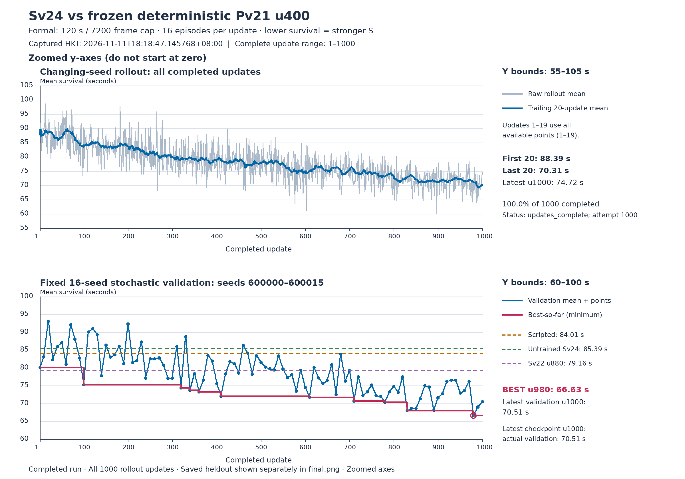
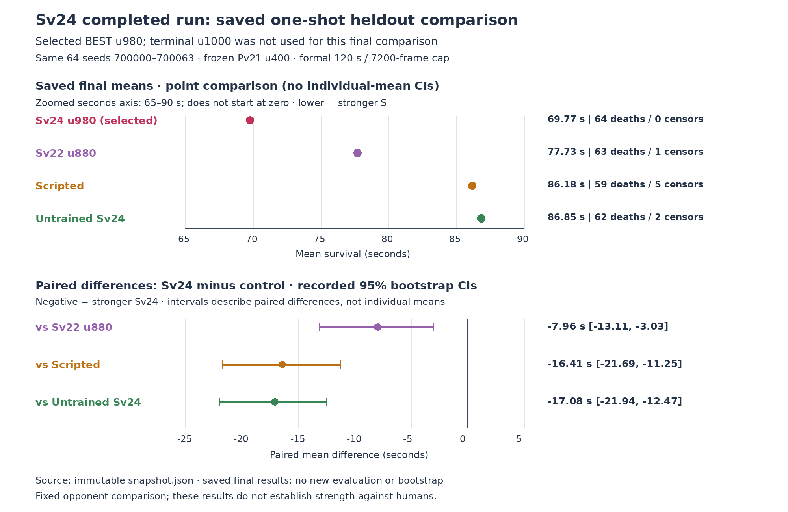

# Qrokkun26

A tiny 2D bullet-dodging survival game. Homage to the 1999 freeware **特訓99** (Tokkun 99), with **original** art, titles, and UI (nothing is copied from 特訓99).

**Made by Grok Bot.** Tribute to 特訓99.

You are a small ship on a cramped playfield. You cannot shoot. Survive as long as you can against nearly-random bullets that get denser and faster over time.

## How to open in Godot 4

1. Install [Godot 4.7+](https://godotengine.org/download) (4.3 or newer should open the project).
2. In Godot, **Import** / **Open** and select `project.godot` in this folder.
3. Press **F5** (Play).

Internal resolution is **320x240**, integer-scaled to a **960x720** window (stretch mode `viewport` + integer scale). Nearest-neighbor filtering. Physics ticks at 60 Hz.

## How to play

| Action | Keys |
|--------|------|
| Move | Arrow keys **or** WASD |
| Start / restart | **Enter**, **Space**, or **Z** |

- Hitbox is slightly smaller than the ship sprite. Contact with a bullet is death.
- In-play HUD shows elapsed time only. That time **is** the score.
- One endless wave. Some bullets come from the edges; some are aimed *near* you (not perfect homing, not memorization patterns).
- From the game-over screen, Enter / Space / Z starts a new run.

### Rank titles

30 seconds is a brag. Around 60 seconds is elite.

| Time | Title |
|------|-------|
| 0s | SPARK |
| 5s | GLINT |
| 10s | NEEDLE |
| 15s | RAZOR |
| 22s | ARC |
| **30s** | **GROKKER** |
| 40s | STORMCUT |
| 50s | IRONWAKE |
| **60s** | **APEX** |
| 75s | MYTHOS |
| 90s | VOIDPILOT |
| 120s | ETERNAL |

## Export (Windows / Linux)

`export_presets.cfg` already defines **Linux** and **Windows Desktop** presets.

1. Godot **Editor -> Manage Export Templates...** and download templates matching your Godot version.
2. **Project -> Export...**
3. Select **Linux** -> Export to `dist/Qrokkun.x86_64`.
4. Select **Windows Desktop** -> Export to `dist/Qrokkun.exe`.

If templates are missing, Godot cannot bake standalone binaries. The presets are still in the project so you can export after installing templates.

This packaged copy does **not** include baked `dist/` binaries unless templates were available on the machine that built it. See `dist/README.txt`.

Command-line example (templates required):

```bash
godot --headless --path . --export-release "Linux" dist/Qrokkun.x86_64
godot --headless --path . --export-release "Windows Desktop" dist/Qrokkun.exe
```

## License

MIT. See `LICENSE`.

Made by Grok Bot. Tribute to 特訓99.

## RL environment (Python)

遊戲與 AI 版本速查及後續追加約定：[版本目錄](docs/AGENT_VERSIONS.md)（Gv20、Pv21、Sv22–Sv24、Pv25 與歷史 v10）。

`qrokkun_env/` is a Godot-free reimplementation of the playfield logic for training:

```bash
python3 -m pytest qrokkun_env/tests qrokkun_ai -q
python3 -c "from qrokkun_env import Qrokkun26Env; e=Qrokkun26Env(seed=0); print(e.reset()); print(e.step(0))"
```

See [docs/ROADMAP.md](docs/ROADMAP.md).

## Playable Gv20 and engine parity

Normal F5 / project launch now uses scripted Gv20. Title, score, hit animation,
and restart remain available. Player speed is 102 with immediate stopping.
All bullets have radius 2.6 and constant velocity. Spawns use a uniform ray
from (160,126) onto x=0..320, y=12..240, independent Gaussian target offsets
(sigma 13.2 per axis), and uniform speed 30..200. The shifted accumulator
starts at frame 0,27,53,79,104; no legacy double spawn or kind effects apply.
Every positive multiple of 60 adds a directly aimed field bullet using the
mean S speed from [frame-60,frame), excluding same-frame S.

Spawning precedes player movement. The reset bullet stays still on counted tick 1 and first moves on tick 2; bullets
added during a tick first move on the following tick. Collision checks use
current poses after movement, with player radius 4 plus bullet radius 2.6,
including newly spawned bullets. Godot Area2D signals lag this rule, so Gv20
resolves overlaps explicitly after movement.

Python string-seeded random.Random and Godot RNG **do not produce equivalent
streams**. Godot has separate S, field, and player RNG objects; QROKKUN_SEED
reproduces Godot runs only. The engine tests record explicit random variates
from real stochastic production spawns, replay them through Python Gv20, and
can inject them into the same production Godot spawner. No learned Sv22 is used.

Run with an existing Python environment containing pytest, numpy, and torch:

```bash
GODOT_BIN=/path/to/godot PYTHONPATH=. python -m pytest tools/test_gv20_godot.py -q
```

The tests use GODOT_BIN, then discover godot or godot4 on PATH; missing Godot
produces an explicit integration-test skip. They import assets before running and
check a fresh project import for parse errors. They run
the actual main scene headlessly, covers three seeds, moving and idle deaths,
actual input-driven title/restart with held movement, death and cleared restart
UI/bullet state, a 7200-tick stochastic schedule, field windows, independent
player draws, and explicit replay. Long schedule runs disable only the collision
resolver in the harness to survive 120 seconds; ordinary replay runs retain it.
The harness also supports GV20_CAPTURE for a real viewport PNG when a display
is accessible. Headless physics tests provide no graphical/manual coverage.

Python legacy Qrokkun26Env, v10 models, and v21 observation/checkpoint contracts
remain intact. The historical monkey fixture and monkey_verify.py describe the
legacy game and should not be used to validate new Gv20 recordings.

### Fixed-rule sanity check

```bash
PYTHONPATH=. python3 -m qrokkun_env.sanity --policy flee --seeds 20 --compare
```

`flee` (away from nearest bullet) vs scripted spawner; `--compare` also runs `idle`.

### Train PlayerV10 (120s cap, zero-inertia physics)

```bash
python3 -m venv .venv && .venv/bin/pip install -r requirements-train.txt
PYTHONPATH=. .venv/bin/python -m qrokkun_ai.v10.train.train_player_v10 --updates 300 --out-dir runs/player_v10
```

Legacy `v0`..`v5` (inertia-era physics) are archived at git tag `legacy-inertia-physics-v5`.

## Project journal

See the [Gv20 Godot integration and verification record](docs/journal/2026-11-10-1794266611-gv20-godot-integration-and-verification.txt) for delivered scope, fixes, verification, and limitations.

Store durable project records in [docs/journal](docs/journal/README.md) as `yyyy-mm-dd-unixtimestamp-topic.txt`, with hyphen-separated topics, actual record creation Unix seconds, and the matching `Asia/Hong_Kong` calendar date. `README.md` is exempt; see the journal README for migration provenance.

Gv20 diagnostic events are disabled by default; the parity harness opts in.
Production speed history retains only the required 60-frame window. The memory
regression runs 7200 ticks without observer clearing. Frame-zero transitions
move neither Player nor the reset bullet. Python Gv20 matches HEAD unchanged.
Fix-pass RED/GREEN evidence is in tmp/gv20/fixpass/; original evidence is retained.
No display was available for this pass, so renderer/manual evidence is outstanding.

Engine subprocesses, including imports, use temporary user-data, config, and
cache directories. Score persistence is verified inside the isolated profile;
input-driven restarts clear the flash timer and alpha at frame zero. Final
RED/GREEN evidence and the concise report are in `tmp/gv20/finalfix/`.
Run the full check with:

```bash
GODOT_BIN=/path/to/godot PYTHONPATH=. python -m pytest tools/test_gv20_godot.py qrokkun_env/tests qrokkun_ai/v10/tests qrokkun_ai/v21/tests -q
```

Sv22 owner-authorized learning experiment: [protocol and local runner](qrokkun_ai/v22/README.md).

Sv22 review operations: see [runner README](qrokkun_ai/v22/README.md) for finite
deadline enforcement, exact formal seed counts, live validation snapshots,
completed-update progress/status, and primary-result preservation before optional
diagnostics. CPU review evidence is in `tmp/sv22/review-fixes/`.

Sv22 owner-stop outcome: [historical training stop report](docs/journal/2026-11-10-1794311518-sv22-training-stop-report.txt).

Sv23 fixed-u1000 owner contract: [policy, tests, and launch handoff](qrokkun_ai/v23/README.md).

Sv23 owner-stop outcome: [training stop report](docs/journal/2026-11-11-1794351856-sv23-training-stop-report.txt).

Sv24 已完成 1000 updates：[訓練完成與正式最終結果報告](docs/journal/2026-11-11-1794395723-sv24-training-completion-report.txt)。固定驗證選出 **best u980**（66.6302 秒），u1000 驗證為 70.50625 秒；正式 heldout 使用 u980，平均玩家存活 69.7685 秒，低於三組對照（對 S 而言越低越好）。



訓練與驗證圖採非零起點放大 y 軸：rollout 55–105 秒、validation 60–100 秒。Best u980 與終點 u1000 為不同 checkpoint。



正式 heldout：每組 64 seeds；均值軸放大為 65–90 秒，差值軸為 −25–5 秒。CI 表示 Sv24 減對照的配對平均差，三組均低於零。這是單一 training seed、固定 Pv21 u400 的結果；該報告當時保存的全套測試快照為 18 failed、134 passed、26 skipped，歷史結果保留於報告。

Sv22 歷史期限測試維護（實作 `8604090`）：[維護回顧與重現證據](docs/journal/2026-11-11-1794397742-sv22-test-deadline-cleanup-report.txt)。修復後獨立重跑全套測試為 **164 passed、26 skipped（35.26s）**；26 skips 不算通過。此為測試維護結果，與上述 Sv24 訓練完成結果分開記錄，正式歷史 cutoff 未放寬。

Pv25 C warm-start 實驗：[owner 合約](docs/journal/2026-11-11-1794400966-pv25-warm-start-contract.txt)、[v25 runner、測試與啟動命令](qrokkun_ai/v25/README.md)。原 Pv21 u400 actor/critic 對固定 Sv24 best u980，fresh Adam，目標為 1000 completed updates。

Pv25 已正式啟動：[啟動證據與快照狀態](docs/journal/2026-11-11-1794403738-pv25-training-launch-report.txt)。截至 2026-11-11 21:28:58 HKT，已完成 8 updates、attempted 9，最近完整驗證為 u0，尚無 final 結果。上述合約與模組 README 的等待 review／smoke／launch 文字是啟動前紀錄，不代表目前仍待啟動；狀態以本次凍結快照為準。

Pv25 完成紀錄（2026-11-12）：已完成 1000 updates，validation best 為 **u670**；一次性全新 heldout 為 69.44245 秒，原 Pv21 u400 為 70.19766 秒，配對差 −0.75521 秒、95% CI [−5.31592, 3.88388] 包含 0，未證實改善或變差。見[訓練完成報告](docs/journal/2026-11-12-1794433829-pv25-training-completion-report.txt)。上述 Nov 11 進度為當時快照，原合約與啟動紀錄保留。

Pv26c／Pv26t 執行等價診斷：[操作與合約](qrokkun_ai/v26/README.md)、[事前合約](docs/journal/2026-11-12-1794460557-pv26-thread-bitwise-contract.txt)、[測試套件精簡紀錄](docs/journal/2026-11-13-1794502979-pv26-test-consolidation-report.txt)（`v26` 測試由 286 項收斂至 41 項通過，全套 `244 passed, 26 skipped`，當時快照尚未啟動 GB10 正式 `u20`）。

Pv26c／Pv26t 完成紀錄（2026-11-14）：GB10 CUDA 正式 `u20`（`Pv26c` `workers=1` 對 `Pv26t` `workers=4`）與離線完整重播比對已完成，結果為 **`complete_equal`**（三階段結束碼 `0/0/0`，`weights_bitwise_equal=true`、`all_updates_weights_bitwise_equal=true`、`full_trace_equal=true`，兩臂各 `1,346,718` 筆事件零差異；原始 203.2 GiB trace 留存於 GB10 本地 NVMe，`trace_durable_bundle=false`）。此為純執行等價診斷，無強度或未加儀器加速結論。見[結案報告](docs/journal/2026-11-14-1794629266-pv26-u20-completion-report.txt)。

Pv27c／Pv27w：新增 [固定 episode spawn worker 實驗](qrokkun_ai/v27/README.md)，原始 Pv21 u400＋fresh Adam、CPU frozen Sv24 u980，u5 終點權重逐位元比較；速度另報。正式執行與 readiness review 由 parent 負責。

Pv27c／Pv27w 結案（2026-11-14）：兩臂正式完成 5/5 updates（exit 0、WEIGHTPASS），u0..u5 每次 12 個具名張量 raw bits 一致、各 240,606 training frames；實際 spawn worker 工作已確認。收集加 batch 組裝慢 4.8263%、全程慢 1.6837%，沒有加速；單一 seed17 配對，無 full trace／heldout／強度或 promotion 結論。見[完成報告](docs/journal/2026-11-14-1794634360-pv27-cw-u5-completion-report.txt)。上述待執行文字保留為歷史快照。

Pv28c／Pv28m 整集平行加速與可重現基準（2026-11-14）：新增 [v28 模組與操作說明](qrokkun_ai/v28/README.md)、[EGM 概念規格書](concepts_brief.md) 與 [事前合約](docs/journal/2026-11-14-1794642996-pv28-cm-preregistration-contract.txt)。單場對戰全在 CPU 獨立完成並透過長駐 `SharedMemory` 子行程池重用，合併後於確定性 CUDA 整批計算老師標籤與 PPO；支援 `u5／u100／u1000` 六位數恢復檢查點、`--resume` 與終點優先／二分搜尋權重比對（準備啟動 GB10 實測）。
